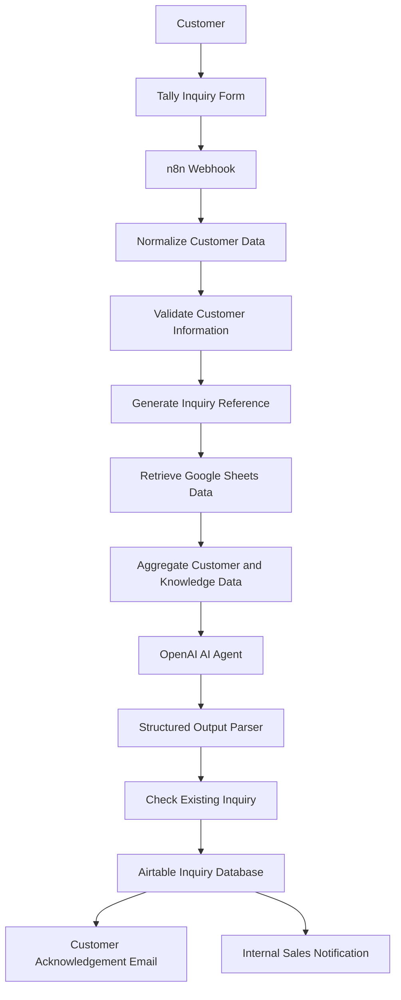

# FreshWave Beverages Ltd. – AI-Powered Customer Inquiry & Lead Qualification System


## 1. Project Overview

The **FreshWave AI-Powered Customer Inquiry & Lead Qualification System** is an intelligent business process automation solution developed using n8n, OpenAI, Google Sheets, Airtable and Tally Forms.

The system automates the process of receiving customer inquiries, retrieving relevant business information, analysing customer intent, qualifying potential leads, storing inquiry records and generating automated email responses.

The solution is designed for FreshWave Beverages Ltd., a fictional beverage distribution company, as an example of how AI agents and workflow automation can improve customer service and sales operations.

The project demonstrates how businesses can leverage AI-powered automation to reduce manual processing, improve response times, standardise customer engagement and provide sales teams with actionable lead information.

## 2. Business Problem

Businesses receive customer inquiries through different channels, including online forms, emails and telephone calls.

Managing these inquiries manually can create several operational challenges:

- Delayed responses to customer inquiries.
- Manual classification and prioritisation of potential customers.
- Inconsistent responses to frequently asked questions.
- Difficulty identifying high-potential sales opportunities.
- Limited visibility into customer inquiry processing.
- Increased administrative workload for customer service and sales teams.
- Risk of overlooking missing or conflicting customer information.

FreshWave requires an automated solution that can receive inquiries, understand customer requirements, provide relevant information and escalate cases requiring human intervention.

## 3. Project Objectives

The main objectives are to:

1. Automate customer inquiry collection through an online form.
2. Validate and standardise customer information.
3. Generate unique inquiry reference numbers.
4. Retrieve relevant product, pricing, policy and FAQ information.
5. Use an OpenAI-powered AI agent to understand and classify customer inquiries.
6. Automatically qualify and score potential sales leads.
7. Detect discrepancies and missing customer information.
8. Store inquiry records and AI analysis in Airtable.
9. Send automated customer acknowledgement emails.
10. Notify internal sales teams about high-potential leads and cases requiring human intervention.

## 4. Technology Stack

| Technology | Purpose |
|---|---|
| n8n Cloud | Workflow automation and orchestration |
| OpenAI GPT-4.1 mini | AI-powered inquiry analysis and lead qualification |
| Tally Forms | Customer inquiry collection |
| Google Sheets | Business knowledge base |
| Airtable | Customer inquiry database and tracking |
| Gmail | Customer acknowledgements and internal notifications |
| GitHub | Source code, workflow documentation and project versioning |

## 5. System Architecture

The solution follows an event-driven automation architecture.



### Workflow Explanation

**1. Customer Inquiry Submission**

Customers submit their inquiries using a Tally form containing:

- Full Name
- Email Address
- Phone Number
- Inquiry Type
- Product Interested In
- Quantity Required
- Customer Location
- Inquiry Details

**2. Webhook Trigger**

The n8n webhook receives the submitted form data and initiates the automation workflow.

**3. Data Normalisation**

A JavaScript Code node extracts and standardises customer information, including resolving Tally dropdown option IDs into readable values.

**4. Customer Information Validation**

The workflow checks whether essential customer information is available and whether the email address follows a valid format.

Invalid submissions are intended to follow a separate error-handling route.

**5. Inquiry Reference Generation**

The system generates a unique inquiry reference using the submission date and Tally submission ID.

Example:

`FW-20261102-123456`

**6. Knowledge Base Retrieval**

Google Sheets provides the AI agent with business information from four worksheets:

- Products
- Pricing
- Policies
- FAQs

The information is aggregated into a single customer inquiry payload.

**7. AI-Powered Inquiry Analysis**

The OpenAI AI agent analyses the customer inquiry alongside the retrieved knowledge base.

It identifies customer intent, categorises inquiries, evaluates lead potential and determines whether human intervention is required.

**8. Structured Output Processing**

The Structured Output Parser ensures that the AI response follows a predefined JSON schema.

This makes it easier for subsequent workflow nodes to process the AI-generated information consistently.

**9. Airtable Database Integration**

The system stores customer information, inquiry details, lead qualification results and processing statuses in Airtable.

A submission ID lookup is used to help prevent duplicate inquiry records.

**10. Email Notifications**

The workflow is designed to send:

- Customer acknowledgement emails confirming receipt of an inquiry.
- Internal sales notifications highlighting high-potential leads and inquiries requiring human intervention.

## 6. AI Agent Capabilities

The FreshWave AI Customer Service and Lead Qualification Agent is designed to perform the following tasks:

### Inquiry Classification

Classifies customer inquiries into categories such as:

- Product Information
- Pricing Inquiry
- Bulk Purchase
- Distribution Partnership
- Product Availability
- General Inquiry
- Complaint

### Lead Qualification

Assigns a numerical score between 0 and 100 based on customer intent and available inquiry information.

| Lead Score | Lead Status |
|---|---|
| 70–100 | High Potential |
| 40–69 | Medium Potential |
| 0–39 | Low Potential |
| Any score requiring escalation | Review Required |

### Quantity Discrepancy Detection

The AI agent compares the quantity entered in the Tally form against the quantity mentioned in the customer's inquiry message.

Example:

- Form quantity: 3 bottles
- Inquiry message: "I would like to purchase 10 Orange Juices."

Expected AI behaviour:

- Flag a quantity discrepancy.
- Request clarification from the customer.
- Set the human review flag.
- Avoid assuming the intended order quantity.

### Human Escalation

The system identifies inquiries requiring human intervention, including:

- Customer complaints.
- Quantity discrepancies.
- Product availability confirmation.
- Special pricing or discount requests.
- Distribution partnership requests.
- Missing or conflicting customer information.
- Inquiries that cannot be resolved using the knowledge base.

## 7. Google Sheets Knowledge Base

The business knowledge base contains fictional and illustrative company information.

| Worksheet | Description |
|---|---|
| Products | Product names, descriptions and product details |
| Pricing | Illustrative product prices and discount tiers |
| Policies | Delivery, payment, returns and ordering policies |
| FAQs | Frequently asked customer questions and answers |
| Sample_Inquiries | Sample customer inquiries for testing |
| Airtable_Field_Map | Database field mapping reference |

### Sample Products

| Product | Pack Size | Illustrative Price |
|---|---|---:|
| Orange Juice | 500ml | KES 100 |
| Cola | 500ml | KES 80 |
| Lemonade | 500ml | KES 90 |
| Mango Juice | 1L | KES 180 |
| Water | 500ml | KES 50 |

**Important:** All product prices, policies and commercial terms are demonstration data. They must not be treated as actual business commitments or live inventory information.

## 8. Airtable Database Design

The Airtable base is named:

`FreshWave Customer Inquiry Management`

The primary table is:

`Customer Inquiries`

It is designed to capture:

### Customer Information
- Inquiry ID
- Tally Submission ID
- Customer Name
- Email
- Phone
- Product
- Quantity
- Location
- Received At

### AI Qualification Information
- Inquiry Category
- Lead Score
- Lead Status
- Qualification Reason
- Customer Intent
- AI Response
- Internal Summary
- Human Review
- Quantity Discrepancy
- Missing Information
- Knowledge Used

### Workflow Tracking
- Processing Status
- Customer Email Status

This structure provides a centralised record of customer inquiries and their processing progress.

## 9. Expected Business Benefits

The solution is intended to deliver the following benefits:

- Faster acknowledgement of customer inquiries.
- Reduced manual data entry.
- Consistent customer communication.
- Improved identification of potential sales opportunities.
- Better prioritisation of sales follow-ups.
- Improved visibility into customer inquiries.
- Reduced risk of incorrect responses through knowledge-based AI processing.
- Improved operational efficiency through workflow automation.

## 10. Security and Governance Considerations

The solution should follow good information security practices:

- Store API keys and credentials securely using n8n credentials.
- Never hardcode passwords, API keys or access tokens in workflow code.
- Restrict access to Airtable customer records.
- Avoid exposing sensitive customer information in unnecessary email notifications.
- Use access-controlled links for internal documents.
- Validate incoming webhook data.
- Maintain appropriate error handling and execution logs.
- Apply data retention and privacy controls.
- Use human approval for cases requiring commercial or operational decisions.

## 11. Project Implementation Status

The project is being developed in phases.

| Phase | Description | Status |
|---|---|---|
| Phase 1 | Business requirements and knowledge base preparation | Completed |
| Phase 2 | Tally integration, webhook, data normalisation, validation and Google Sheets retrieval | Completed |
| Phase 3 | OpenAI AI agent and structured output configuration | In Progress |
| Phase 4 | Airtable database integration | In Progress |
| Phase 5 | Gmail customer and internal notifications | Pending |
| Phase 6 | Error handling, testing and workflow optimisation | Pending |
| Phase 7 | Documentation, GitHub publication and demonstration | Pending |

## 12. Testing Scenarios

The following scenarios will be used to validate the system:

| Test Scenario | Expected Result |
|---|---|
| Valid product pricing inquiry | AI retrieves relevant illustrative pricing |
| Bulk purchase inquiry | AI identifies bulk purchase intent |
| Quantity mismatch | AI flags discrepancy and requests clarification |
| Missing customer email | Validation rejects the submission |
| Product availability inquiry | AI avoids inventing stock information |
| Customer complaint | AI flags the inquiry for human review |
| Distribution partnership inquiry | AI identifies the opportunity and escalates |
| Duplicate submission | Existing inquiry is identified before creating a new record |

## 13. Repository Structure

The proposed GitHub repository structure is:

```text
FreshWave-AI-Customer-Inquiry-System/
│
├── README.md
│
├── workflow/
│   └── FreshWave_n8n_Workflow.json
│
├── knowledge-base/
│   └── FreshWave_Phase1_Data_Pack.xlsx
│
├── documentation/
│   ├── System_Architecture.md
│   ├── Workflow_Configuration.md
│   ├── Airtable_Database_Design.md
│   └── Testing_and_Validation.md
│
├── screenshots/
│   ├── Tally_Form.png
│   ├── n8n_Workflow.png
│   ├── Google_Sheets_Knowledge_Base.png
│   ├── Airtable_Database.png
│   └── AI_Agent_Output.png
│
└── demo/
    └── Demo_Instructions.md
```

The workflow export should be reviewed before publication to ensure credentials, tokens and sensitive data are not included.

## 14. Future Enhancements

Potential improvements include:

- WhatsApp integration for customer inquiries.
- AI-powered sentiment analysis.
- Sales performance dashboards.
- Advanced lead scoring based on customer behaviour.
- Automated sales follow-up reminders.
- Integration with CRM platforms.
- Multi-language customer support.
- Human approval workflows for sensitive customer requests.
- Monitoring and reporting of workflow execution performance.

## 15. Installation and Setup

### Prerequisites

You will need:

1. An n8n Cloud account.
2. An OpenAI API account with available API billing and usage limits.
3. A Tally account.
4. A Google account with access to Google Sheets.
5. An Airtable account.
6. A Gmail account or supported email integration.

### Basic Setup

1. Create the FreshWave customer inquiry form in Tally.
2. Prepare the Google Sheets knowledge base.
3. Create the Airtable base and configure its fields.
4. Configure the n8n webhook to receive Tally submissions.
5. Configure data normalisation and validation.
6. Connect Google Sheets to retrieve business information.
7. Configure the OpenAI AI agent and Structured Output Parser.
8. Connect Airtable to store inquiry records.
9. Configure Gmail notifications.
10. Test the workflow using the documented test scenarios.

## 16. Disclaimer

FreshWave Beverages Ltd. is a fictional company created for demonstration, learning and capstone project purposes.

The project uses illustrative products, pricing, policies and customer inquiry data. It is not intended to represent a live commercial business or production-ready customer service platform.

## 17. Author

**Project:** FreshWave AI-Powered Customer Inquiry & Lead Qualification System

**Category:** AI Agents | Business Process Automation | Workflow Automation

**Primary Platform:** n8n Cloud

**AI Integration:** OpenAI

**Repository:** FreshWave-AI-Customer-Inquiry-System

---

*This project demonstrates the practical application of AI agents and workflow automation in solving real-world business process challenges.*
